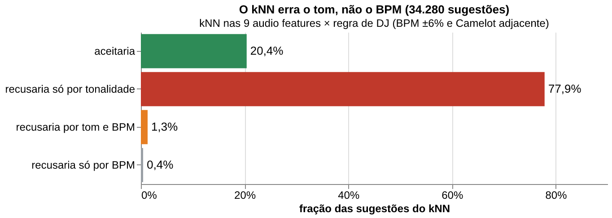
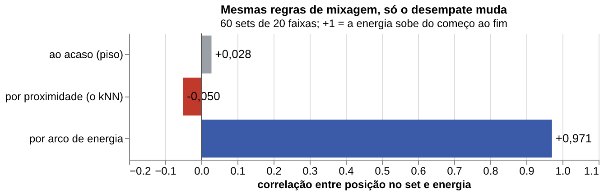
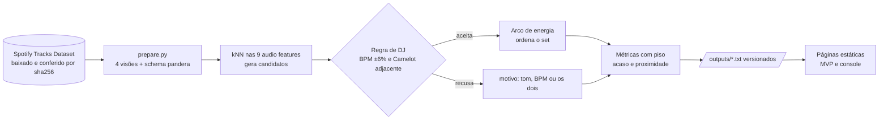
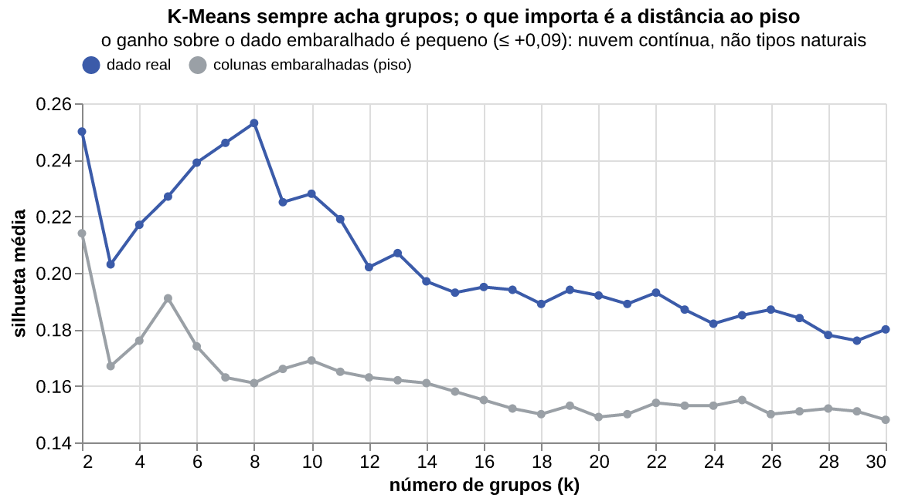

# O DJ e o modelo: quando "soa parecido" não é "mixa bem"

Análise do *Spotify Tracks Dataset* (114 mil linhas, 114 gêneros) que terminou numa ferramenta
para montar set de DJ e em testes que mostram onde ela erra. O trabalho nasceu de
um desafio da Residência em IA da UnB, feito em equipe de 6 pessoas. Este repositório reúne a
minha frente: análise estatística, modelos e validação.

**[MVP: o DJ contra o kNN](https://matheushpr94.github.io/dj-vs-knn-spotify/mvp.html)** ·
**[Console de parâmetros](https://matheushpr94.github.io/dj-vs-knn-spotify/console.html)**

## O resultado em 3 números

| Pergunta | Resultado | Base de comparação |
|---|---|---|
| O DJ aceitaria o que o kNN sugere? | **recusaria 79,6%**, sendo 77,9% só por tonalidade | ignorando o tom, a recusa cai para 1,7% |
| Ordenar o set por arco de energia funciona? | correlação posição × energia de **+0,971** | acaso: +0,028 · escolha por proximidade: −0,050 |
| Dar pesos diferentes às features melhora o escore? | **+1,0 ponto** na metade de busca e **+0,0 na reserva** | peso igual para todas |



Como `tempo` é uma das 9 features, o kNN já puxa faixas de andamento parecido, e só 0,4% das
recusas são por BPM. `key` e `mode` ficaram fora das features, e são justamente elas que
decidem se a transição soa bem. Quase toda a recusa vem daí.



Eu esperava que escolher sempre a faixa mais parecida desse um set coerente. Deu um resultado
pior que sortear: a mais parecida costuma ter a mesma energia, e o set não sai do lugar. Quando
passei a usar `energy` para decidir a ordem, mantendo as mesmas regras de mixagem, a correlação
foi de −0,050 para +0,971.

## Arquitetura



## Decisões, cada uma com a alternativa descartada

| Decisão | Alternativa descartada, e por quê |
|---|---|
| kNN para gerar candidatos e regra de domínio para decidir | **só kNN:** ele é cego a `key` e `mode`, e o DJ recusaria 79,6% do que ele sugere |
| Regra de Camelot em 30 linhas (`src/camelot.py`) | **PyCamelot:** a tabela de 24 posições e 4 vizinhas cabe no repositório, auditável e sem dependência |
| Desempate explícito no dedup (`["popularity", "track_genre"]`) | **`kind="stable"`:** só garante "mesma entrada, mesma saída". Ao embaralhar as linhas, milhares de gêneros mudavam (seção 4.2 da [metodologia](docs/METODOLOGIA.md)) |
| `popularity` como filtro, nunca como alvo | **prever popularidade:** o modelo erra 12,7 pontos, e chutar a mediana erra 14,8. Além disso, 14,1% dos valores são censura (cópias delistadas) |
| Peso igual para as 9 features no escore de pertencimento | **pesos otimizados:** o melhor de 200 sorteios ganhou +1,0 ponto onde a busca olhou e +0,0 onde não olhou |
| k = 7 a 8 grupos como **faixa**, não como ponto | **"o k ótimo é 10":** o pico da silhueta muda com a semente. A estabilidade (ARI) e o HDBSCAN dizem que a música é uma nuvem contínua, não tipos naturais |

## Por que não prever popularidade

O R² foi 0,19. Em pontos, o modelo erra 12,7 numa escala de 0 a 100, contra 14,8 de quem chuta
sempre a mediana. O alvo também tem problemas próprios: pelo cartão oficial, `popularity` mede o
quanto a faixa tocou recentemente; 14,1% dos valores são zeros de cópias delistadas (a cópia viva
da mesma música tem mediana 67); e 720 `track_id` têm popularidade diferente conforme o gênero.
Por isso usei popularidade só como filtro.

## O que a análise mostrou sobre o dado



- **O som identifica o gênero quando o gênero é funcional:** a Random Forest acerta
  `study`, `sleep` e `comedy` em 80% ou mais, e quase nunca acerta `reggaeton`, `mpb` ou
  `techno`, que são gêneros culturais. No total, **35,0%** de acerto top-1 contra 0,88% do acaso
  ([06](outputs/06-o-som-identifica-o-genero.txt)).
- **87% do que parecia "impossível" era música:** de 1.221 linhas fora do domínio do cartão
  oficial, só 158 eram defeito de extração. As outras eram ambient, comédia e clássico sem
  compasso regular ([metodologia, 4.3](docs/METODOLOGIA.md)).
- **Um filtro comum de curadoria derruba hits:** `popularity <= 10` remove cópias delistadas
  de "Blinding Lights" e "Starboy", cuja gêmea viva tem popularidade 90 ou mais
  ([09](outputs/09-filtro-de-popularidade-erra.txt)).

## Limitações

- **Não há transição real de DJ no dataset.** Esta análise mede coerência interna (a regra de
  manual), não acerto contra a prática. Os dados que permitiriam isso existem (1001Tracklists,
  DJ Mix Dataset, EDM-CUE) e são o próximo passo natural.
- **Não há ouvinte.** O que se mede é se a transição é tecnicamente compatível, o que dá para
  verificar sem usuário. Gosto musical fica de fora.
- **A coluna `key` não tem marcador de ausência confiável.** Uma tonalidade mal detectada vira
  uma tonalidade errada, sem aviso.
- **A amostra foi montada**, com exatamente 1.000 faixas por gênero. Nenhuma frase sobre
  "o gênero mais popular" generaliza para o catálogo.

## Como usei assistente de IA, e como a medição pegou os erros dele

Boa parte do código foi escrita com um assistente de IA. Ele achou coisas que eu teria
deixado passar: o arquivo alternativo da residência estava corrompido (a coluna `popularity`
tinha sido ordenada sozinha) e o desempate do dedup era arbitrário. Também errou: apontou um
vazamento que não existia, tratou 163 linhas como um defeito só e chutou números sem rodar o
código. Os acertos vieram quando ele mediu; os erros, quando deduziu sem conferir.

O que pegou esses erros foram verificações automáticas: piso em toda saída, divisão
busca/reserva feita antes da busca, `--conferir` e um registro das tentativas que falharam. A
busca de pesos é o exemplo mais claro. Em minutos o assistente testou 200 combinações e achou
+1,0 ponto; na metade reservada o ganho foi zero. Com um assistente, testar muitas variações
fica barato, e a reserva é o que impede de publicar a que deu certo por acaso.

## Reproduzir

```bash
uv sync
uv run python baixar_dados.py                 # baixa do Hugging Face e confere o sha256
uv run python src/rodar_tudo.py --conferir    # roda tudo e compara com outputs/
```

O esperado é `0 mudou | 0 falha(s)`. Para rodar uma pergunta só, use
`uv run python src/rodar_tudo.py p11`. As figuras saem de
`uv run --group figuras python src/figuras.py`, lidas das saídas, sem recalcular.

| Pasta | Conteúdo |
|---|---|
| `src/prepare.py` | preparo canônico: toda análise entra por aqui |
| `src/pNN_*.py` | uma pergunta por script, na ordem de leitura |
| `outputs/NN-*.txt` | a resposta de cada script, com pergunta, método e piso no cabeçalho |
| `docs/METODOLOGIA.md` | técnicas, métricas e as conclusões que mudaram no caminho |
| `docs/METODO.md` | como conduzir uma análise: famílias de técnica, vazamento e as perguntas das duas primeiras horas |
| `docs/*.html` | as páginas estáticas do MVP e do console (GitHub Pages) |
| `notebooks/` | o notebook marimo que escolheu a tarefa |

## Dados e licença

**Dados:** [Spotify Tracks Dataset](https://huggingface.co/datasets/maharshipandya/spotify-tracks-dataset),
de Maharshi Pandya, coletado da Web API do Spotify. No Kaggle a licença é "Database: Open
Database, Contents: © Original Authors". O CSV **não é redistribuído aqui**: `baixar_dados.py`
baixa a cópia pública e confere o sha256 `b202fa49…1177bd`. As páginas do MVP e do console
trazem nomes de faixas e de artistas, que pertencem aos seus autores.

**Código:** MIT. Projeto independente, sem afiliação com o Spotify.
